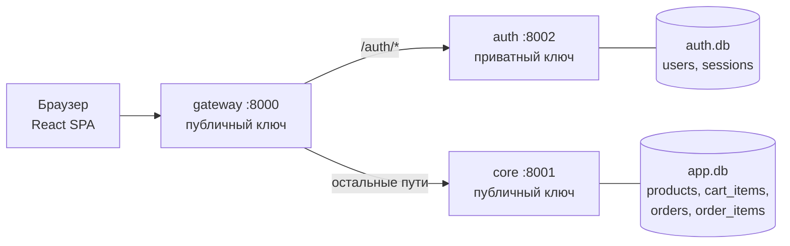
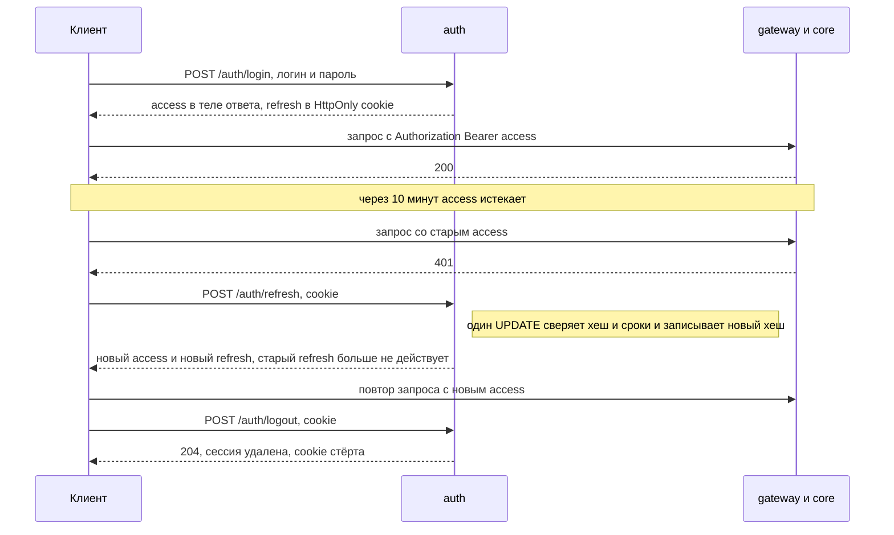

# Koi Market


Koi Market — интернет-магазин одежды, в котором главное внимание уделено реализации и защите auth-сервиса: access JWT на асимметричной подписи, refresh-токены с ротацией и обнаружением кражи, сессии с отзывом. Каждое решение в README разобрано по схеме «проблема → решение → код», а сознательные компромиссы вынесены в отдельный раздел.

## Архитектура



**auth** — отвечает за пользователей и сессии: регистрация, вход, выдача и ротация токенов, выход и отзыв сессий админом. Только он хранит пароли и держит приватный ключ, которым подписывает access-токены.

**gateway** — единая точка входа. Пропускает только известные маршруты, на защищённых проверяет подпись access и проксирует запрос дальше.

**core** — магазин: каталог, корзина, заказы. Токен проверяет ещё раз сам.

**frontend** — React SPA для демонстрации.

Базы у auth и core раздельные. core не видит ни паролей, ни сессий и знает о пользователе только то, что пришло в токене: `sub`, `username` и `role`.

## Как работают токены

| | Access | Refresh |
|---|---|---|
| Формат | JWT с подписью EdDSA (Ed25519) | непрозрачный токен `<семейство>.<секрет>` |
| Срок жизни | 10 минут | 7 дней, продлевается при каждом обновлении. Сессия в целом живёт не дольше 30 дней с момента входа |
| Где у клиента | in-memory, заголовок `Authorization: Bearer …` | cookie `refresh_token` с флагами `HttpOnly`, `Secure`, `SameSite=Strict`, `Path=/auth` |
| Где на сервере | нигде, проверяется по подписи | SHA-256 токена и семейства в таблице `sessions` |
| Как отозвать | никак, истекает сам | выход, новый вход, отзыв админом, повторное использование токена |
| Что внутри | `sub`, `username`, `role`, `sid`, `exp` | ничего |



## Проблемы и решения

### Токены и срок жизни

| Проблема | Решение | Код |
|---|---|---|
| Токен, который уходит в каждый запрос и живёт долго, легко утекает и долго остаётся рабочим | Два токена. Access уходит в каждый запрос и живёт 10 минут. Refresh живёт дольше, но браузер отправляет его только на `/auth/*` | [`config.py`](auth/app/config.py) |
| Активного пользователя не хочется выкидывать, а брошенная сессия не должна жить вечно | Refresh живёт 7 дней и продлевается при каждом обновлении. Кто заходит регулярно, остаётся в системе(до 30 дней), а брошенная сессия истекает через неделю | [`routes.py`](auth/app/routes.py) |
| Злоумышленник перехватил чужой access (например, через поддельную точку Wi-Fi), входит под своим логином и пытается обменять свой refresh вместе с чужим access на новый чужой access, чтобы продлевать украденную сессию | `/auth/refresh` не принимает access вовсе. Новый access собирается только из сессии, найденной по хешу refresh: `sub` — владелец сессии, `sid` — её id, имя и роль — из таблицы `users`. Свой refresh даёт только свой access | [`routes.py`](auth/app/routes.py) |
| Если злоумышленник с украденным refresh обновится первым, сессия останется у него, а владелец просто вылетит | Обнаружение повторного использования. У всех refresh одной сессии общее семейство — первая часть токена. Если приходит уже заменённый токен из семейства действующей сессии, значит, токен украден. Кто из двоих вор, понять нельзя, поэтому сессия завершается для обоих. Просто истёкший текущий токен кражей не считается | [`routes.py`](auth/app/routes.py) |

### Разделение сервисов

| Проблема | Решение | Код |
|---|---|---|
| Если каждый сервис проверяет пароли сам, хеши и логика входа копируются в каждый из них, и взлом любого сервиса отдаёт базу паролей | Пароли и сессии есть только у auth, в отдельной БД `auth.db`. core не видит ни паролей, ни сессий и знает о пользователе только то, что пришло в токене | [`models.py`](auth/app/models.py) |
| Уязвимость в любой точке проекта открыла бы доступ к паролям и сессиям пользователей | Пароли и сессии хранятся только в auth, в отдельном процессе и своей БД `auth.db`. Поэтому SQL-инъекция или обход пути в core до паролей и сессий не дотягиваются | [`routes.py`](auth/app/routes.py) |
| Если бы токен умел проверять только auth, каждый запрос ходил бы в него по сети: auth стал бы узким местом и единой точкой отказа | gateway и core проверяют access сами, по публичному ключу. В auth ходят только для входа и обновлений — примерно раз в 10 минут на пользователя. | [`security.py`](gateway/app/security.py) |

### Cookie

| Проблема | Решение | Код |
|---|---|---|
| XSS может прочитать токен из JS и унести долгоживущую сессию | Refresh лежит в `HttpOnly` cookie, JS его не видит. Access приходит в теле ответа, и клиент держит его в памяти, а не в `localStorage` | [`routes.py`](auth/app/routes.py) |
| Refresh уходил бы во все сервисы и оседал в их логах | `Path=/auth`: браузер отправляет cookie только на пути auth | [`routes.py`](auth/app/routes.py) |

### Сессии и отзыв

| Проблема | Решение | Код |
|---|---|---|
| Чистый stateless JWT нельзя завершить| Сессия хранится в БД, поэтому выход и отзыв админом завершают её по-настоящему | [`models.py`](auth/app/models.py) |
| При подозрении на взлом ждать, пока истечёт refresh, слишком долго | Админ завершает сессию пользователя через `POST /auth/admin/users/{username}/revoke` | [`routes.py`](auth/app/routes.py) |

### Подпись JWT и ключи

| Проблема | Решение | Код |
|---|---|---|
| С общим секретом (HS256) взлом любого сервиса, который проверяет токены, позволяет выпускать свои, в том числе с `role=admin` | Асимметричная подпись: приватный ключ есть только у auth, gateway и core получают только публичный | [`security.py`](auth/app/security.py) |
| Подмена алгоритма: токен с `alg=none` или HS256-токен, подписанный публичным ключом как HMAC-секретом | Список алгоритмов задан жёстко: `algorithms=["EdDSA"]` | [`security.py`](auth/app/security.py) |

## Принятые риски

- **Access нельзя отозвать.** После выхода, отзыва сессии или снятия роли он действует до `exp`, то есть до 10 минут.
- **Одна сессия на пользователя.** Вход с нового устройства завершает сессию на старом.
- **Регистрация показывает, что логин занят** (ответ `409`). На входе это скрыто одинаковым текстом ошибки и временем ответа, но для системы с логинами такое обычно неизбежно: пользователь должен узнать, что имя занято. Ограничивать перебор должен rate limit, а его пока нет.

##  TODO 

- [ ] Перейти на nginx и добавить Rate limit 
- [ ] Реализовать возможность использования нескольких одновременных сессий(например с пк и телефона)
- [ ] Добавить redis с blacklist access токенов 

## API

| Метод | Путь | Кому | Ответ |
|---|---|---|---|
| `POST` | `/auth/register` | всем | `201` с `id`, `username`, `role`; `409`, если логин занят |
| `POST` | `/auth/login` | всем | `200` с `access_token`, `token_type`, `expires_in` и refresh-cookie; `401`, если логин или пароль неверны |
| `POST` | `/auth/refresh` | по cookie | `200` с новым access и новой cookie; `401`, если cookie нет, она истекла или уже заменена |
| `POST` | `/auth/logout` | всем | всегда `204`: сессия удаляется, cookie стирается |
| `POST` | `/auth/admin/users/{username}/revoke` | админу | `204`; `404`, если пользователя нет |

Тело регистрации и входа — `{"username": "…", "password": "…"}`. Логин — от 3 до 32 символов из `[A-Za-z0-9_]`, пароль — от 8 до 128 символов, лишние поля дают `422`.

Админский эндпоинт требует access-токен с ролью `admin`: без токена ответ `401`, с ролью `user` — `403`.

Пример на curl:

```bash
# регистрация
curl -X POST localhost:8002/auth/register \
  -H 'Content-Type: application/json' \
  -d '{"username": "alice", "password": "correct-horse-1"}'

# вход: access придёт в теле ответа, refresh — в cookie, curl сохранит её в файл jar
curl -i -c jar -X POST localhost:8002/auth/login \
  -H 'Content-Type: application/json' \
  -d '{"username": "alice", "password": "correct-horse-1"}'

# обновление: в jar окажется новый refresh, старый перестанет работать
curl -b jar -c jar -X POST localhost:8002/auth/refresh

# выход
curl -b jar -c jar -X POST localhost:8002/auth/logout
```

Ответ на вход (сокращённо):

```http
HTTP/1.1 200 OK
content-type: application/json
set-cookie: refresh_token=<семейство>.<секрет>; HttpOnly; Max-Age=604800; Path=/auth; SameSite=strict; Secure

{"access_token":"eyJhbGciOiJFZERTQSIsInR5cCI6IkpXVCJ9…","token_type":"Bearer","expires_in":600}
```

## Запуск

Нужны Python 3.13 и, для фронтенда, Node.js 20.19+ или 22.12+.

### auth

```bash
cd auth
python3 -m venv venv
source venv/bin/activate
pip install -r requirements.txt

# пара ключей Ed25519: keys/private.pem (права 0600) и keys/public.pem
python scripts/gen_keys.py

# публичный ключ нужен сервисам, которые проверяют токены
mkdir -p ../gateway/keys ../core/keys
cp keys/public.pem ../gateway/keys/
cp keys/public.pem ../core/keys/

# администратор, пароль спросит интерактивно
python -m app.cli create-admin admin

uvicorn app.main:app --port 8002
```

Настройки читаются из переменных окружения или из `.env` в папке `auth/` (пример — [`.env.example`](auth/.env.example)). Значений по умолчанию хватает для локального запуска.

| Переменная | По умолчанию | Что задаёт |
|---|---|---|
| `AUTH_DATABASE_URL` | `sqlite+aiosqlite:///./auth.db` | БД пользователей и сессий |
| `AUTH_PRIVATE_KEY_PATH` | `keys/private.pem` | приватный ключ Ed25519 |
| `AUTH_COOKIE_SECURE` | `true` | флаг `Secure` у refresh-cookie |
| `AUTH_ACCESS_TTL_SECONDS` | `600` | срок жизни access (10 минут) |
| `AUTH_REFRESH_TTL_SECONDS` | `604800` | срок жизни refresh (7 дней) |
| `AUTH_SESSION_MAX_AGE_SECONDS` | `2592000` | абсолютный предел сессии (30 дней) |

Если браузер не сохраняет cookie на `http://localhost`, для локальной разработки поставьте `AUTH_COOKIE_SECURE=false`.

### Остальные сервисы

Каждый запускается в своём терминале и из своей папки: пути к ключам и базам относительные.

```bash
# gateway, на него ходит фронтенд
cd gateway
python3 -m venv venv && source venv/bin/activate
pip install -r requirements.txt
uvicorn app.main:app --port 8000
```

```bash
# core
cd core
python3 -m venv venv && source venv/bin/activate
pip install -r requirements.txt
uvicorn app.main:app --port 8001
```

```bash
# frontend
cd frontend
npm install
npm run dev
```

Откройте http://localhost:5173. Именно `localhost`, а не `127.0.0.1`: gateway разрешает CORS только для этого адреса.

Каталог после первого запуска пустой. Товары добавляет админ на странице «Админ: товары», картинки лежат в `core/app/static/products/` (путь вида `/static/products/<файл>.jpg`).

## Структура репозитория

```text
auth/                   сервис аутентификации, основная часть проекта
├── app/
│   ├── routes.py       эндпоинты /auth/*: вход, обновление, выход, отзыв
│   ├── security.py     argon2id, подпись и проверка JWT, refresh-токены
│   ├── models.py       таблицы users и sessions
│   ├── schemas.py      валидация входных данных
│   ├── deps.py         проверка роли админа
│   ├── config.py       настройки AUTH_*
│   ├── db.py           async SQLAlchemy
│   ├── main.py         приложение FastAPI, загрузка ключа при старте
│   └── cli.py          create-admin
└── scripts/
    └── gen_keys.py     генерация пары ключей Ed25519
gateway/                прокси: проверяет подпись access и пересылает запросы
core/                   каталог, корзина, заказы
frontend/               React SPA для демонстрации
```
